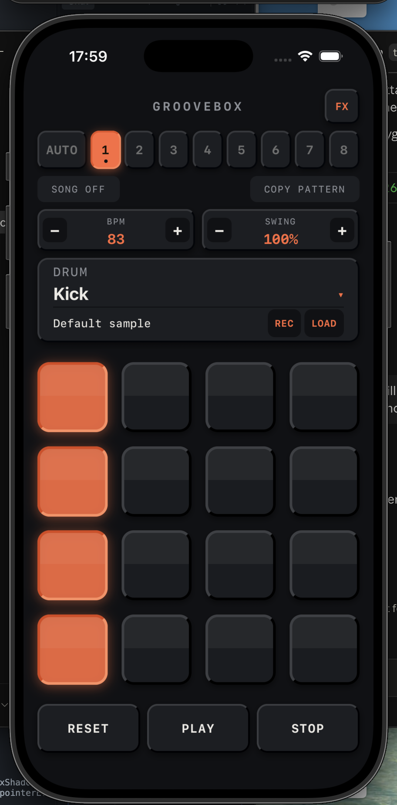
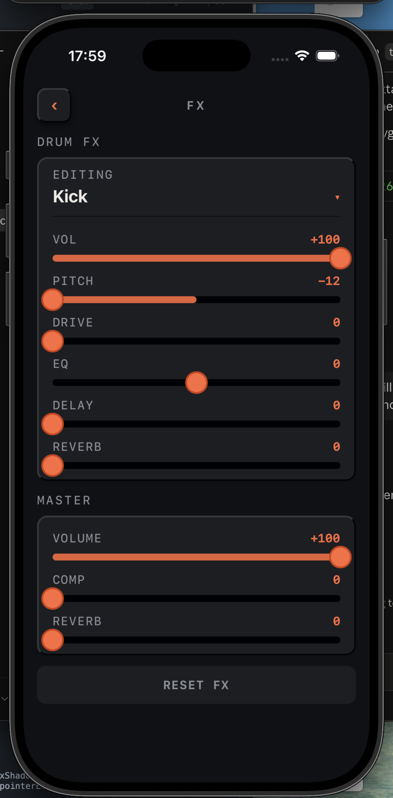
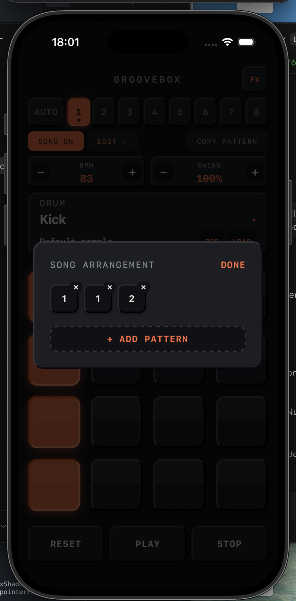

# Groovebox

A hardware-style 16-step drum sequencer for iOS and Android, built with React Native + Expo. Program beats on a tactile 4×4 pad grid, layer FX per drum, chain patterns into full songs, and record your own samples straight from the mic.

<p align="center">
  
  
  
</p>

## Features

- **4×4 step grid** — 16 steps per pattern, presented as tactile hardware pads rather than a flat DAW grid. Long-press a step to cycle its velocity/accent.
- **8 pattern banks** — switch between 8 independent patterns per drum kit. **AUTO** chains through them automatically at the end of each loop, skipping any pattern that's still empty.
- **Song Mode** — build an ordered arrangement out of your 8 patterns (repeats allowed) and play it straight through as one song.
- **Per-drum FX** — Volume, Pitch (±1 octave, chromatic), Drive, EQ, Delay, and Reverb, editable per instrument.
- **Master FX** — master Volume, Compressor, and Reverb across the whole kit.
- **Custom samples** — **LOAD** a sample from a file, or **REC** one straight from the phone's microphone. Either way, the result is trimmable in the same waveform editor.
- **Swing & BPM** — adjustable groove and tempo, changeable live without restarting playback.
- **Copy pattern, reset (pattern or all)** — standard housekeeping, with hold-to-confirm on the destructive ones.

## Tech stack

- [Expo](https://expo.dev) (SDK 57) + React Native, TypeScript, Expo Router
- [`react-native-audio-api`](https://github.com/software-mansion/react-native-audio-api) — a Web-Audio-API-shaped native audio engine (own AudioContext/AudioNode graph, not `expo-av`)
- `expo-file-system` for sample import/export

## Getting started

**Prerequisites:** Node.js, and either Xcode (iOS) or Android Studio (Android) set up for React Native development — this project uses native modules, so it will not run inside Expo Go.

```bash
npm install
```

Then run on a simulator/emulator or a connected device:

```bash
npx expo run:ios
# or
npx expo run:android
```

### ⚠️ Important: the audio library is pinned to a nightly build, on purpose

`react-native-audio-api`'s latest **stable** release does not produce any audible output at all on the iOS 26 Simulator — it hits [a known, still-open upstream bug](https://github.com/software-mansion/react-native-audio-api/issues/671) (`HALC_ProxyIOContext::IOWorkLoop: skipping cycle due to overload`). This project pins an exact nightly build (`1.0.0-nightly-a8925b5-20260909`, see `package.json`) that resolves it. **Don't casually bump this dependency** — verify sound actually works on-device first if you do.

That nightly also has its own small bug: its native `DelayNode` has `getInput()`/`getOutput()` reversed, which silently makes the DELAY effect do nothing at all. This repo carries a patch for it — see `scripts/patch-audio-api-delay.js`, which reapplies automatically via `postinstall` after every `npm install` (manual `node_modules` edits alone don't survive a fresh install, so this is the mechanism that makes DELAY work out of the box for anyone cloning the repo). The same pattern already existed here for [a separate web-only crash fix](scripts/patch-audio-api-web.js).

**Native patches only take effect after a native rebuild** (`npx expo run:ios` / `npx expo run:android`), not a JS-only reload — if you change the pinned version or edit either patch script, rebuild before testing.

### iOS Simulator microphone

Recording (REC) needs a host microphone selected in **Simulator → I/O → Audio Input** — otherwise the recording will fail to start even with permissions granted.

## Project structure

```
src/
  app/            Expo Router screens (main sequencer, FX page)
  audio/          Audio engine, FX chain, scheduler, recording
  components/     UI components, organized by screen area
  state/          App-wide state (patterns, playback, FX, song, custom samples)
  storage/        AsyncStorage/file persistence
  constants/      Drum/FX/theme definitions
scripts/          postinstall patches for react-native-audio-api (see above)
```

## License

MIT — see [LICENSE](LICENSE).
